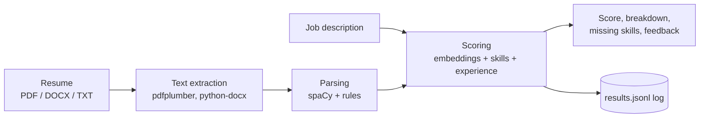

<h1 align="center">AI Resume Analyzer + EDA</h1>
<p align="center"><strong>Semantic resume-to-job matching with weighted scoring, skill-gap feedback, and a Streamlit interface</strong></p>

<p align="center">
  <a href="https://github.com/Nirrmitt/AI-Resume-Analyzer-plus-EDA"></a>
  <a href="https://nirrmitt.github.io/NRT-Terminal/demos/resume.html"></a>
  <a href="https://www.python.org"></a>
  <a href="https://spacy.io"></a>
  <a href="https://www.sbert.net"></a>
  <a href="https://streamlit.io"></a>
  
</p>

A resume-screening tool that scores how well a resume fits a job description. It combines **sentence-embedding similarity** (`all-MiniLM-L6-v2`), **keyword and spaCy-entity skill extraction**, and a **rule-based experience parser** into one weighted score, then explains the result with a score breakdown, missing skills, and feedback. It accepts PDF, DOCX, and TXT resumes and runs from a CLI or a Streamlit app. Every run is also appended to a log that the included notebook uses for exploratory analysis.

**Project:** [Source code](https://github.com/Nirrmitt/AI-Resume-Analyzer-plus-EDA) · [Live in-browser demo](https://nirrmitt.github.io/NRT-Terminal/demos/resume.html) · [Portfolio](https://nirrmitt.github.io/NRT-Terminal)

> **Demo scope:** the live demo is a lightweight in-browser version. It uses the same weights, skill list, and feedback rules, but substitutes **TF-IDF cosine similarity** for SentenceTransformers and offers an optional ×2 calibration heuristic of my own to compensate for TF-IDF's lower scores. Files never leave your browser. For the real embedding model, run the project locally.

## Contents

- [What it demonstrates](#what-it-demonstrates)
- [How scoring works](#how-scoring-works)
- [Architecture](#architecture)
- [Run it locally](#run-it-locally)
- [Example output](#example-output)
- [Configuration](#configuration)
- [Project structure](#project-structure)
- [Known limitations and next steps](#known-limitations-and-next-steps)

## What it demonstrates

- **Applied NLP:** transformer embeddings for semantic similarity, spaCy entities plus a curated skill dictionary for extraction, and regex rules for experience and education.
- **Interpretable scoring:** the final number is a transparent weighted sum, so each component can be inspected and tuned.
- **Actionable output:** matched and missing skills and plain-language feedback, not just a score.
- **Configuration over code:** weights, thresholds, model name, and limits live in `config.yaml`.
- **Two interfaces, one core:** the same `ResumeAnalyzer` powers the CLI and the Streamlit app.
- **Exploratory analysis:** each run is logged to `data/results.jsonl` for the EDA notebook.

## How scoring works

| Component | Weight | How it is computed |
| --- | --- | --- |
| Semantic similarity | 0.45 | Cosine similarity between resume and job-description embeddings |
| Skill match | 0.35 | Share of the job description's recognised skills found in the resume (0.5 if none are recognised) |
| Experience relevance | 0.20 | Cosine similarity between the first three experience entries and the job description (0.5 if none are found) |

The weighted sum is scaled to 0–100 and labelled **Strong**, **Good**, or **Weak** using the thresholds in `config.yaml`. Skills come from a built-in dictionary of about 40 common skills plus spaCy entities. Resumes under 50 words return an error instead of a score.

## Architecture



## Run it locally

```bash
git clone https://github.com/Nirrmitt/AI-Resume-Analyzer-plus-EDA.git
cd AI-Resume-Analyzer-plus-EDA
pip install -r requirements.txt
python -m spacy download en_core_web_sm
```

**Web app**

```bash
streamlit run app.py
```

**CLI**

```bash
python main.py --resume data/sample_resume.txt --job "Senior Python developer with AWS, Docker, FastAPI and CI/CD experience" --output result.json
```

The first run downloads the embedding model, so it needs an internet connection.

## Example output

The analyzer returns a structure like this (values illustrative):

```json
{
  "overall_score": 71.3,
  "match_level": "Good",
  "breakdown": {
    "semantic_similarity": 68.2,
    "skill_match": 75.0,
    "experience_relevance": 66.5
  },
  "extracted_skills": ["python", "docker", "sql"],
  "missing_skills": ["aws", "ci/cd"],
  "feedback": ["Consider adding these key skills: aws, ci/cd"]
}
```

## Configuration

`config.yaml` controls the scoring weights (`semantic`, `skills`, `experience`), the match thresholds (`strong_match: 80`, `good_match: 65`, `weak_match: 45`), the embedding and spaCy models, and the extraction and feedback limits. Swap in another SentenceTransformers model by changing `model.embedding`.

## Project structure

```text
├── app.py                   # Streamlit app
├── main.py                  # CLI
├── config.yaml              # Weights, thresholds, models, limits
├── requirements.txt
├── src/
│   ├── extractor.py         # PDF / DOCX / TXT text extraction
│   ├── parser.py            # Skills, experience, education parsing
│   ├── analyzer.py          # Embeddings, scoring, feedback, run log
│   └── utils.py
├── data/                    # Sample resume and run logs
└── notebooks/               # EDA notebook
```

## Known limitations and next steps

- **Heuristic parsing:** experience detection looks for month-year patterns on short lines, so unusual resume layouts can be missed or mis-split. Education matching uses simple keywords.
- **Skill vocabulary:** the skill dictionary is small and fixed, and spaCy entity labels can add noisy "skills".
- **No benchmark:** the scoring has not been validated against labelled hiring outcomes, so the number is a guide, not a hiring decision. No accuracy, precision, or recall figures are claimed.
- **No automated tests or CI yet.**
- **Next steps:** layout-aware parsing, a larger skills taxonomy, a small labelled evaluation set with precision/recall reporting, and an optional FastAPI endpoint.


## 🤝 Connect & Contribute
I’m always open to feedback, collaboration, or chat about analytics engineering, automation, or data storytelling.

📧 Email: nirrmit.rtickoo@gmail.com

🌐 Portfolio: [NRT](https://nirrmitt.github.io/NRT-Terminal)

💼 LinkedIn: [Nirrmit R. Tickoo](https://www.linkedin.com/in/n-r-t/)

🐙 GitHub: [ @nirrmitt](https://github.com/Nirrmitt)

🔧 Found a bug or have an idea? Open an issue or submit a PR. I review all contributions!

### 📜 License
MIT ©[Nirrmitt](https://nirrmitt.github.io/NRT-Terminal) Feel free to use, adapt, and build upon this for your own projects or learning journey.
